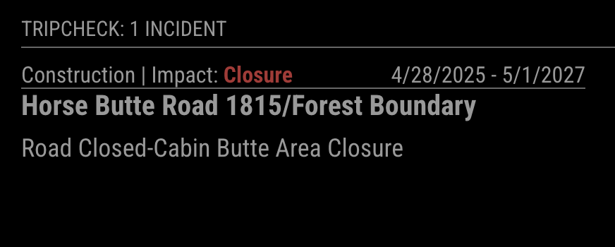

# MMM-ODOT-TripCheck

*MMM-ODOT-TripCheck* is a module for [MagicMirror²](https://github.com/MagicMirrorOrg/MagicMirror) that displays incident details for the state of Oregon. For TripCheck API details, see https://apiportal.odot.state.or.us .

## Screenshot



## Installation

### Install

In your terminal, go to the modules directory and clone the repository:

```bash
cd ~/MagicMirror/modules
git clone https://github.com/ardentras/MMM-ODOT-TripCheck
```

### Update

Go to the module directory and pull the latest changes:

```bash
cd ~/MagicMirror/modules/MMM-ODOT-TripCheck
git pull
```

## Configuration

To use this module, you have to add a configuration object to the modules array in the `config/config.js` file.

### Example configuration

Minimal configuration to use the module:

```js
    {
        module: 'MMM-ODOT-TripCheck',
        position: 'lower_third',
        config: {
            apiKey: tripcheckToken
        }
    },
```

Configuration with all options:

```js
    {
        module: 'MMM-ODOT-TripCheck',
        position: 'lower_third',
        config: {
            apiKey: tripcheckToken,
            incidents: {
                bounds: "-121.30374,43.915940,-121.160000,43.986210",
                local: {
                    display: true,
                    eventTypes: ["Construction", "Detour", "Vehicle Restriction"],
                    impactTypes: ["High", "Closed"],
                    sourceAgency: "USDA, Forest Service - Deschutes NF",
                    excludeEventIds: [4846]
                },
                state: {
                    display: true,
                    eventTypes: ["Road Work", "Vehicle Incident", "Obstruction"],
                    impactTypes: [0,1,2,3,4,5],
                    routeIds: ["US97"],
                    activeEvents: true,
                    excludeEventIds: ["26T03948"]
                }
            }
        }
    },
```

### Configuration options

Option|Possible values|Default|Description
------|------|------|-----------
`apiKey`|`string`|None (required)|API key for access to the ODOT API
`incidents.bounds`|`string`|None|Lon/Lat rectangle bounds to filter: minLon,minLat,maxLon,maxLat
`incidents.local.display`|`bool`|true|Whether to show incidents from local agencies
`incidents.local.eventTypes`|`list(string)`|None|A list of event types to filter by as returned by `http://api.odot.state.or.us/tripcheck/Tle/TleWazeMetadata` under `TLE-incident-items.TLE-incd-type-list`
`incidents.local.impactTypes`|`list(string)`|None|A list of impact types to filter by as returned by `http://api.odot.state.or.us/tripcheck/Tle/TleWazeMetadata` under `TLE-incident-items.TLE-travel-impact-list`
`incidents.local.sourceAgency`|`string`|None|The local agency responsible for the local incident
`incidents.local.excludeEventIds`|`list(int)`|None|A list of local event IDs to hide from display
`incidents.state.display`|`bool`|true|Whether to show incidents from ODOT
`incidents.state.eventTypes`|`list(string)`|None|A list of event types to filter by as returned by `http://api.odot.state.or.us/tripcheck/Incidents/Metadata` under `incident-metadata-items.event-types`
`incidents.state.impactTypes`|`list(int)`|None|A list of impact type IDs to filter by. For example, [1,2,5]
`incidents.state.routeIds`|`list(string)`|None|A list of route names to filter by as returned by `http://api.odot.state.or.us/tripcheck/Routes` under `location-list`
`incidents.state.activeEvents`|`bool`|true|Filters to only active events. Set to `false` to additionally list inactive events
`incidents.state.excludeEventIds`|`list(string)`|None|A list of state event IDs to hide from display

## Sending notifications to the module

Notification|Description
------|-----------

## Developer commands

- `npm install` - Install devDependencies like ESLint.
- `node --run lint` - Run linting and formatter checks.
- `node --run lint:fix` - Fix linting and formatter issues.

## License

This project is licensed under the MIT License - see the [LICENSE](LICENSE.md) file for details.

## Changelog

All notable changes to this project will be documented in the [CHANGELOG.md](CHANGELOG.md) file.
